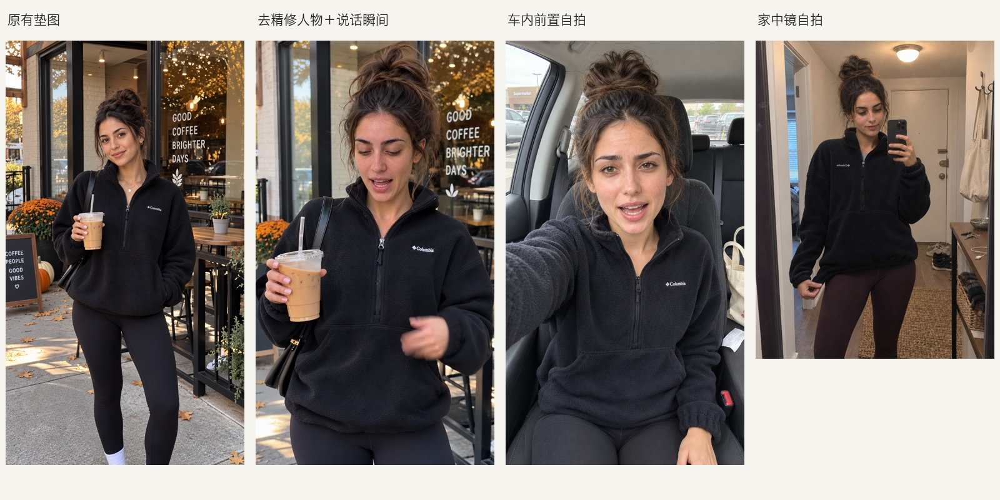
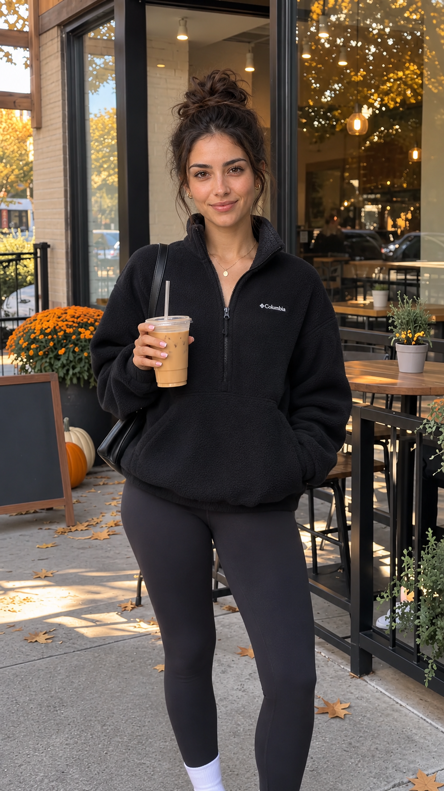
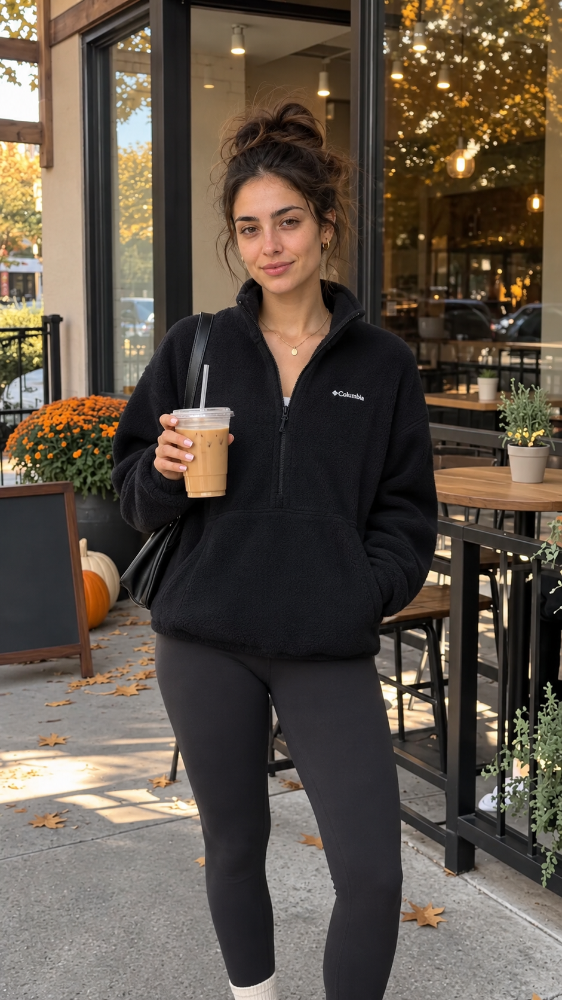
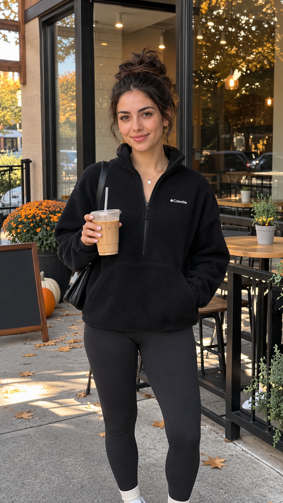
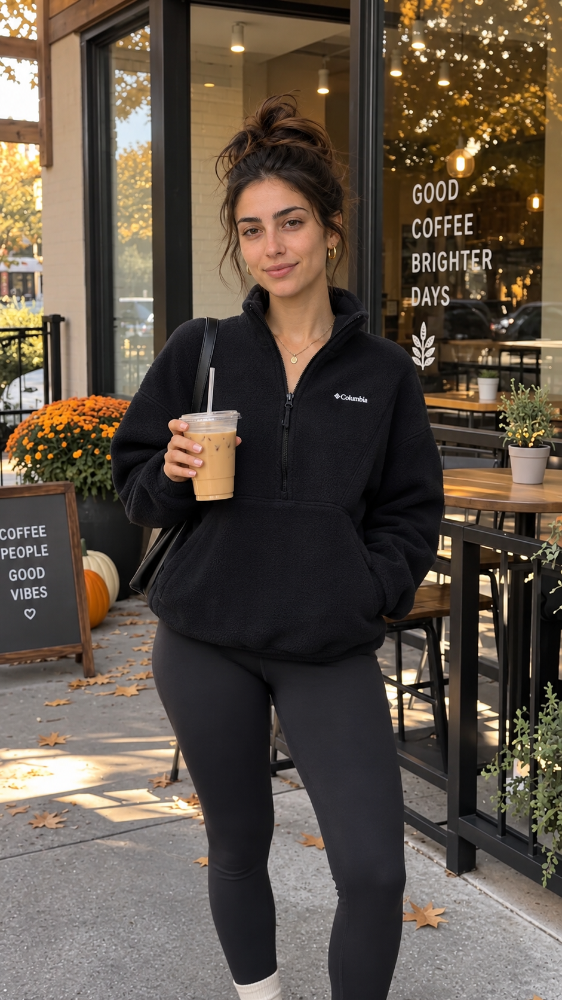
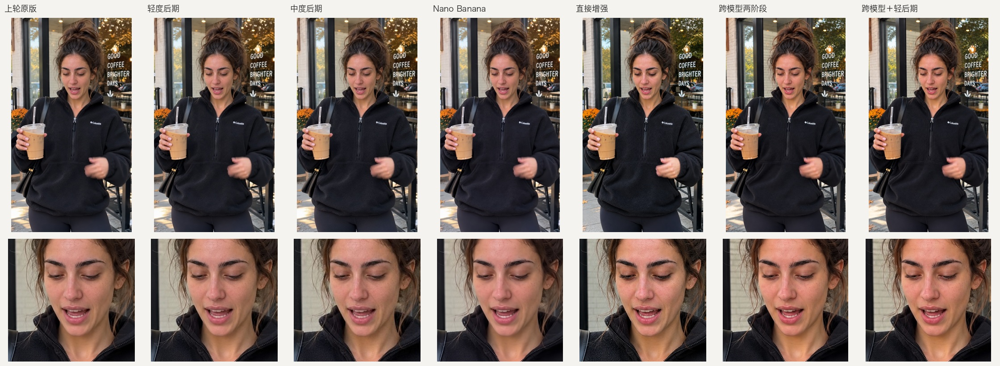

# 生活感生图 · Lifestyle Image

一句话，让 Agent 帮你生成更像日常手机随拍的场景、人像与商品 UGC 图片。

不用自己填写机位、光线、设备表格。Skill 会根据用途补齐拍摄条件，分清参考图的角色，保住人物身份和商品细节，并在出图后检查具体破绽。

## 效果对比

以下是形成这套 Skill 的已有实验样张，均为 **AI 生成／编辑结果**，不是人物实拍，也不是安装 Skill 前后的自动评测。图中“原版”指此前生成的图片。这里展示具体做法和观察，不承诺任何模型、人物或题材都能复现同样提升。点击图片可放大。

### 1. 从摆拍状态到日常拍摄



| 方向（从左到右） | 具体改变 | 观察与代价 |
| --- | --- | --- |
| 原有垫图 | 作为此前效果的参照 | 正面微笑、站姿和布光较整齐，接近穿搭写真 |
| 说话瞬间 | 换成说话中的原帧，搭配减弱精修的人物参考，明确参考只提供身份 | 张嘴、视线和手势更像正在交流；同时改变了原帧时点、景别与人物参考 |
| 车内前置自拍 | 改变持机关系、场景、表情与车窗光 | 更接近自拍视频的一帧；已经换场景，不能直接替换原咖啡店镜头 |
| 家中镜自拍 | 换成玄关镜面、室内光与持手机姿态，并局部修正镜像标识 | 日常拍摄关系更明确；仍需检查镜像、商品标识和参考图服装串入 |

这组比较的是**不同拍摄方案**，不是对同一张图加三种滤镜。改善来自多项组合，不能把收益全部归给某一句提示词。

### 2. 只换人物参考，会发生什么？

保持生产提示词、底图、商品图及参考图顺序不变，只把人物参考换成减弱精修的版本。两组各独立生成两次；下面展示的是生成结果，不是人物参考原图。

| 原人物参考生成 | 减弱精修参考生成 |
| --- | --- |
|  |  |
| 独立生成 A：原参考 | 独立生成 A：更换参考 |
|  |  |
| 独立生成 B：原参考 | 独立生成 B：更换参考 |

**观察：** 两次更换参考后的眼妆都较轻，但站姿和闭嘴微笑仍有摆拍感。上游参考会影响妆造与质感，单靠去妆不足以改变人物状态；已有明确妆容要求时，也不应擅自去妆。未锁定随机种子，背景文字等细节亦有波动，这不是严格的因果证明。

### 3. 好图继续增强：跨模型与实际降级后期



从左到右：**上轮原版 → 轻度后期 → 中度后期 → Nano Banana Pro → 原版直接增强 → 跨模型两阶段 → 跨模型＋轻后期**。上排看整体，下排看脸部；点击放大更容易看出差异。

- **跨模型两阶段：** 已有好图先经 Nano Banana Pro 编辑，再交给内置生图增强。直接增强组与跨模型第二阶段使用同一句 `Enhance this photo and make it look more realistic.`。这组没有显示跨模型的一致优势，皮肤和衣料细节也会被重绘。
- **实际降级后期：** 使用确定性的缩放、轻微模糊、噪声与 JPEG 压缩，另存版本。轻档较克制，中档开始损失细节；它不能修复结构或身份错误。
- **对 Skill 的影响：** 保留清晰原版，满意就停；跨模型和降级后期都不作为默认必经步骤。

轻后期样本参数为长边不超过 1600px、Gaussian blur 0.22px、8-bit 亮度噪声 σ0.8／色噪 σ0.15、JPEG quality 91。它只是本次试过的配方，不是通用最优值。完整适用边界见 [实验结论](skills/lifestyle-image/references/evidence.md)。

## 一条命令安装

先安装 Node.js（包含 `npx`）和 Git，然后在终端运行：

```bash
npx -y skills add scotti1i/lifestyle-image -g --all
```

这会通过 [Skills CLI](https://github.com/vercel-labs/skills) 安装到其支持的 Agent 目录。安装后重新打开 Agent 会话。

只装到 Codex，可用：

```bash
npx -y skills add scotti1i/lifestyle-image -g -a codex -y
```

也可 [下载 ZIP](https://github.com/scotti1i/lifestyle-image/archive/refs/heads/main.zip)，将其中的 `skills/lifestyle-image` 整个目录放入你的 Agent 支持的 skills 目录。

## 直接这样说

在 Codex 中可以显式使用 `$lifestyle-image`：

> 用 $lifestyle-image 生成一个纽约公寓客厅，像普通人用手机拍的。

> 帮我生一张有圣诞装饰的美国家庭客厅，生活一点。

> 用这张人物图和商品图，做一个自然的试穿画面，保留人物身份和衣服结构。

> 这张图有点 AI 感，看看哪里不自然，保留已经好的地方再改。

支持自动发现 Skill 的 Agent 也可以根据请求加载；其他 Agent 按各自的 Skill 调用方式使用。

## 需要什么

这是给 Agent 的生图方法和工作指引，**不包含生图模型、API 密钥或免费额度**。Agent 还需要有可用的图片生成／编辑工具；有内置工具时优先使用内置工具。只有文字能力的环境可以整理提示词，但不能凭安装本 Skill 就生成图片。

使用外部模型时，沿用你配置的渠道、权限与计费方式。无需连接作者的服务，也无需提供作者项目中的素材。

## 沉淀了哪些经验

- 先确定谁在拍、正在做什么、光从哪里来，再写合理可见的细节。
- 人物、商品、空间、原帧参考各有作用，避免把参考中的衣服、妆造和布光一起带入新图。
- 保留自然明暗、肤色和材质；加毛孔、加噪点、做旧、糊脸都不是默认步骤。
- 先看实际输出，再针对手部、接触、镜像、服装串图等问题局部返修；满意就停。
- 跨模型两阶段与真实降级后期按需尝试，保留原版，不承诺它们必然更好。

具体规则见 [手机生活感](skills/lifestyle-image/references/phone-life.md)，实验观察与限制见 [经验依据](skills/lifestyle-image/references/evidence.md)。

## 边界与验证

适用于日常场景、人像、商品 UGC 和已有图片的自然感调整。明确要求的棚拍、插画、电影风格应按原需求执行；不处理文案去 AI 味。

方法来自小样本探索，包含成功与失败经验，没有盲评或通用成功率证明。仓库仅附精选 AI 实验结果与对比图，不附带原始人物照片、商品参考资产或私有项目。安装检查验证文件完整性，不代表所有 Agent、模型或题材都经过出图测试。

## 文件

```text
skills/lifestyle-image/
├── SKILL.md                 # 入口：理解请求、调用工具、检查与收尾
├── agents/openai.yaml       # Codex 展示与发现配置
└── references/
    ├── phone-life.md        # 核心经验
    └── evidence.md          # 已有观察及适用边界
```

MIT License。
